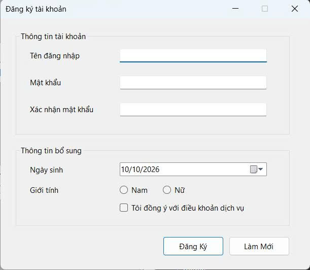
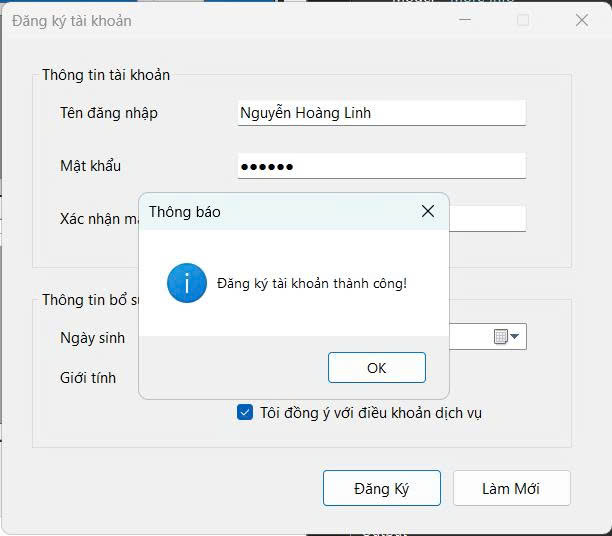
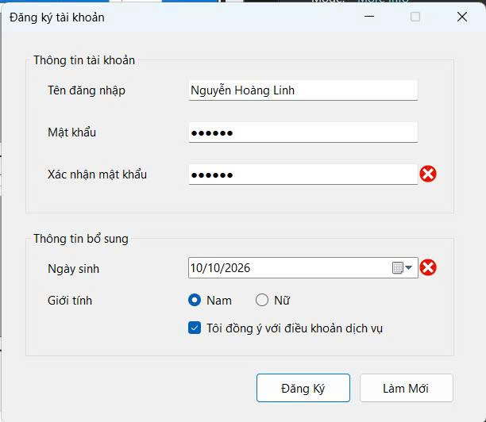
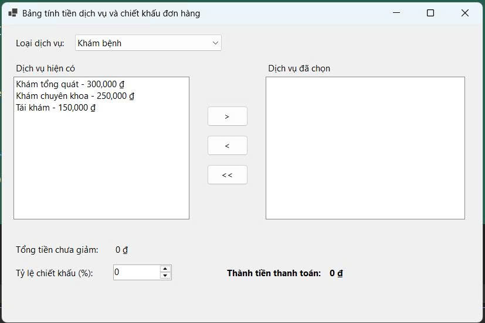
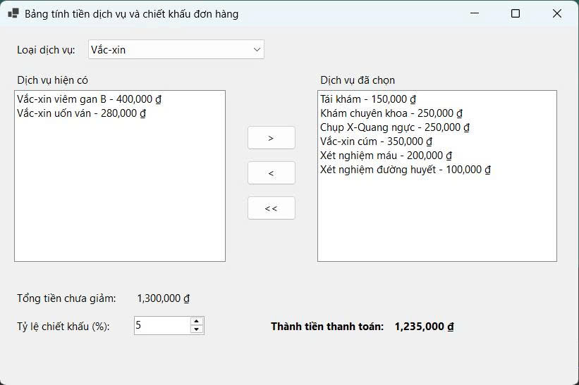
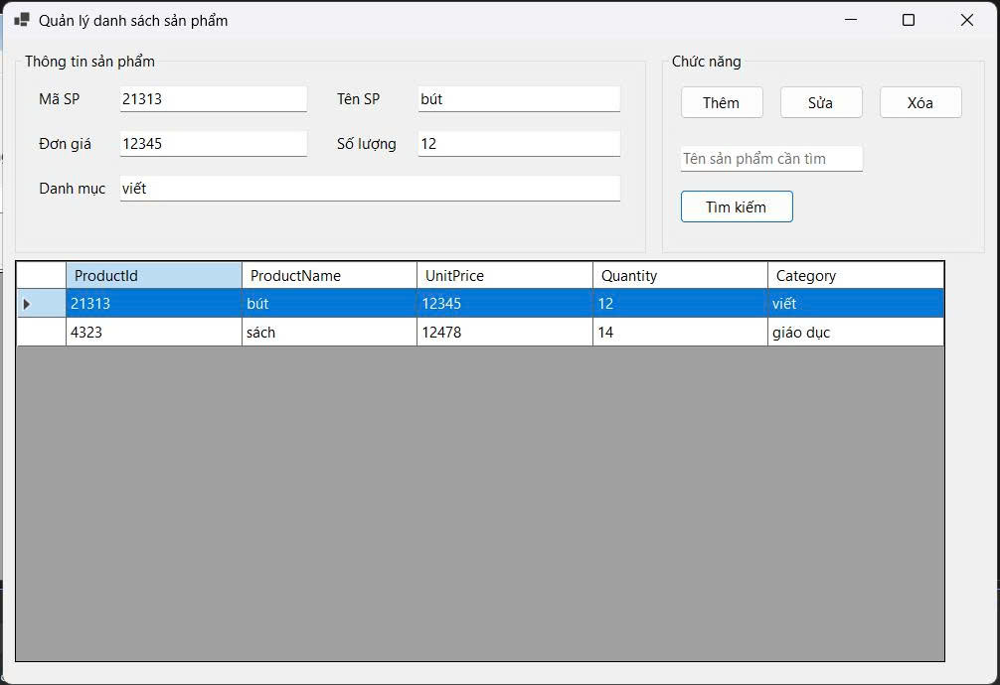
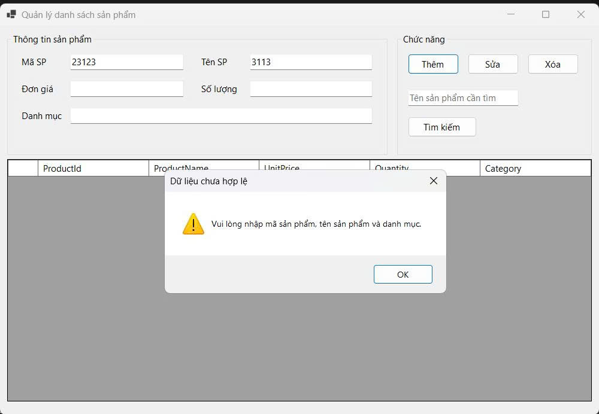
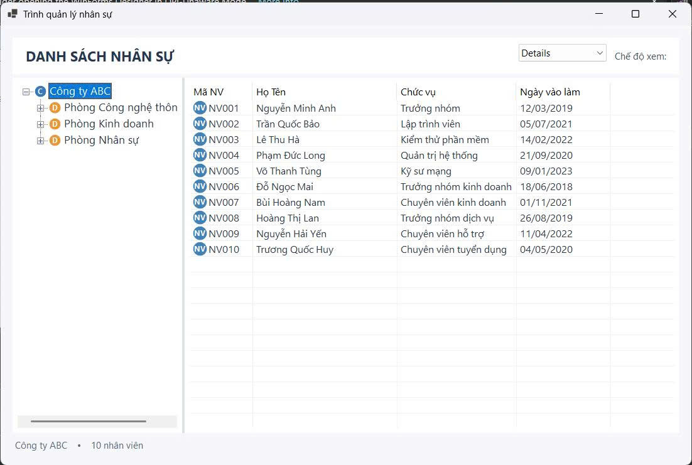

# BÁO CÁO BÀI TẬP / ĐỒ ÁN

## THÔNG TIN SINH VIÊN
- **Họ và tên:** Nguyễn Hoàng Linh
- **Mã số sinh viên:** 24810320338
- **Lớp:** D19QTANM1
- **Tên môn học:** Lập trình C# / Windows Forms
- **Tên bài tập:** Thực hành 

---

## KẾT QUẢ THỰC HÀNH

### **B 5.1:**
### 1. Ảnh màn hình Giao diện chính

### 2. Ảnh màn hình Chức năng thực thi / Kết quả

### 3. Ảnh màn hình Kiểm tra lỗi (Validation)

---
### **B 5.2:**
### 1. Ảnh màn hình Giao diện chính

### 2. Ảnh màn hình Chức năng thực thi / Kết quả

---
### **B 5.3:**
### 1. Ảnh màn hình Giao diện chính

### 2. Ảnh màn hình Chức năng thực thi / Kết quả
 
.jpg)

### 3. Ảnh màn hình Kiểm tra lỗi (Validation)

---
### **B 5.4:**
### 1. Ảnh màn hình Giao diện chính

.jpg)
